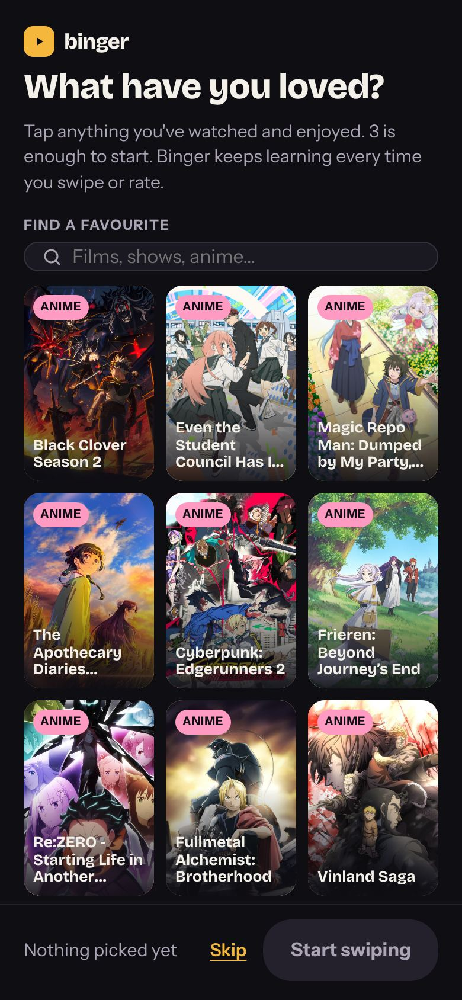
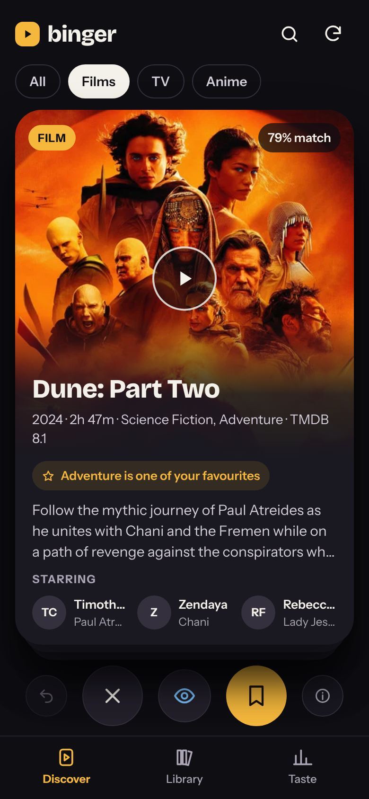
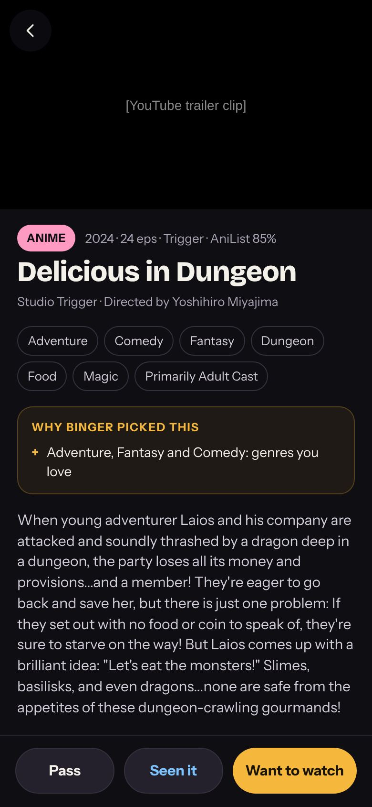
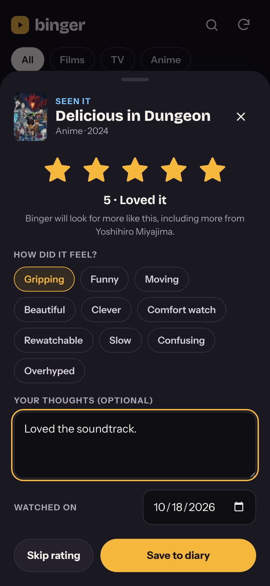
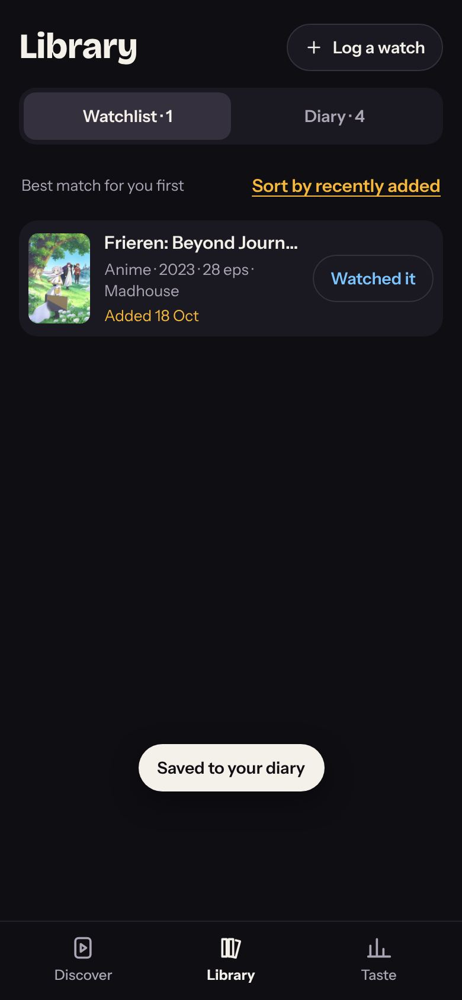
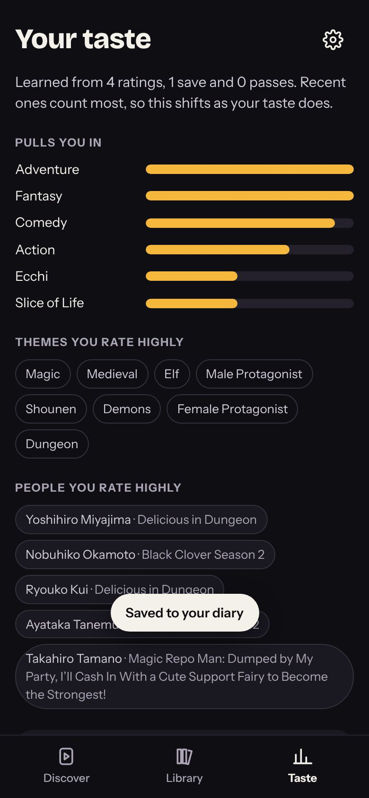

# Binger

Swipe through films, TV and anime like Tinder. Right to save it, left to
pass, up if you've already seen it (then rate it). Every swipe and rating
teaches Binger your taste, and every card tells you why it was picked:
*"Because you loved Arrival"*, *"Stars Zendaya, from Euphoria"*,
*"Next part of Frieren, which you watched"*.

| First run | Discover | Detail | Rate | Library | Taste |
|---|---|---|---|---|---|
|  |  |  |  |  |  |

- **Artwork, synopsis, key people, trailer clips.** People you'd recognise
  from your own history come first.
- **Track and review.** Diary with half-star ratings, feeling tags, reviews and rewatches.
- **Steer it.** Films/TV/Anime mix, favour new releases, surprise me, hide genres.
- **Always current.** Live data from TMDB (films, TV) and AniList (anime):
  this week's trending, new releases, shows airing now, the current anime season.
- **Yours.** Your library stays on your device. Export/import backups anytime.

**Plan, status and handover: [docs/PLAN.md](docs/PLAN.md)**. Start there.

## Use it

1. Open the app (GitHub Pages: `https://emmachilds98-wq.github.io/Binger/` once Pages is on).
2. Pick a few things you've loved.
3. For films and TV, add a free TMDB key: make an account at
   [themoviedb.org](https://www.themoviedb.org/signup), go to
   **Settings → API**, then in Binger open **Taste → ⚙ → TMDB key → Test & save**.
   Either the API Key or the Read Access Token works. Anime works without one.
4. Add it to your home screen (iPhone: Share → Add to Home Screen).

## Develop

No build step, no dependencies to install for the app itself.

```bash
npm run serve   # http://localhost:8080
npm test        # unit tests (Node 20+)
npm run check   # syntax-check every JS file
npm run e2e     # browser run with mocked APIs (needs Playwright), refreshes docs/screenshots
npm run bump    # set version + build time from the real UTC clock
```

How it's put together: [docs/ARCHITECTURE.md](docs/ARCHITECTURE.md).
Look and feel: [docs/DESIGN.md](docs/DESIGN.md).
Rules for changing it: [CLAUDE.md](CLAUDE.md).

## Deploy

GitHub Pages from `main`: **Settings → Pages → Deploy from a branch → `main` / `(root)`**.
The service worker is network-first, so a merge goes live on the next open.

## Credits

Film and TV data from [TMDB](https://www.themoviedb.org). This product uses
the TMDB API but is not endorsed or certified by TMDB. Streaming availability
from JustWatch, via TMDB. Anime data from [AniList](https://anilist.co).
Trailers from YouTube.
